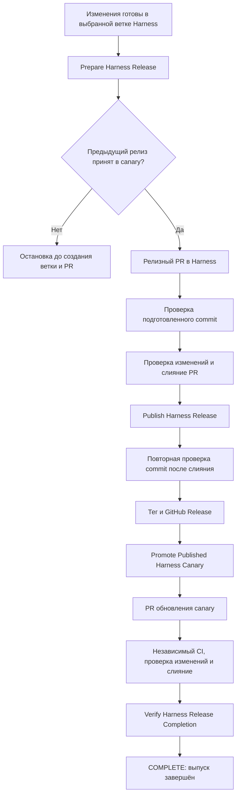
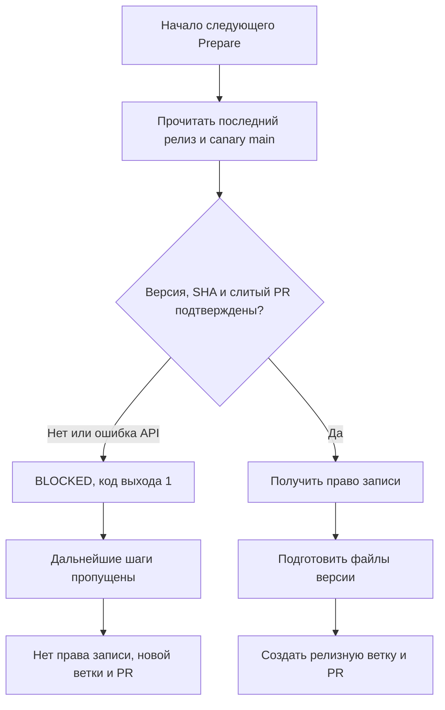
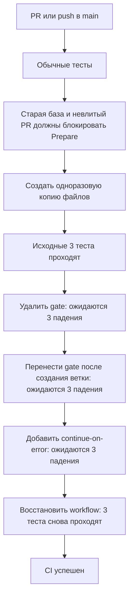

# AI Development Harness — Maintainer Tools

Этот репозиторий содержит инструменты для выпуска **самого AI Development Harness**. Они работают в GitHub Actions и не устанавливаются в пользовательские проекты вместе с Harness.

**Выпуск заканчивается, когда релиз опубликован, а его версия принята в `release-canary/main`.** Одного опубликованного тега или открытого PR обновления canary недостаточно. Если предыдущий выпуск не завершён, подготовка следующего останавливается.

## Кто за что отвечает

| Репозиторий | Назначение |
| --- | --- |
| [`maintainer-tools`](https://github.com/ai-development-harness/maintainer-tools) | Запускает подготовку, проверки, публикацию и обновление canary |
| [`ai-development-harness-template`](https://github.com/ai-development-harness/ai-development-harness-template) | Хранит код Harness, релизные PR, теги и опубликованные версии |
| [`release-canary`](https://github.com/ai-development-harness/release-canary) | Хранит пример уже настроенного проекта, на котором проверяется обновление Harness |

Canary — это контрольный проект. Его ветка `main` содержит принятую стабильную версию. Следующий релиз проверяется на отдельной копии этого проекта, поэтому сами проверки не меняют принятую базу.

Под *promotion PR* ниже понимается PR, который обновляет canary до уже опубликованного релиза. Ответственный за выпуск — человек или агент, которому поручен весь выпуск, — проверяет и сливает оба PR: релизный и canary.

## Как связаны процессы

Обычное слияние изменений в Harness не выпускает релиз. Подготовка и публикация запускаются отдельно; проверки между ними выполняются автоматически.



Стрелки через проверки означают переход только при успехе. Созданный promotion PR ещё не завершает выпуск: до его слияния проверка завершения возвращает `BLOCKED`.

| Процесс в Actions | Когда запускается | Что делает |
| --- | --- | --- |
| [Prepare Harness Release](https://github.com/ai-development-harness/maintainer-tools/actions/workflows/prepare-release.yml) | Вручную | Проверяет предыдущий выпуск, подготавливает версию и открывает релизный PR |
| [Harness Release Qualification](https://github.com/ai-development-harness/maintainer-tools/actions/workflows/release-qualification.yml) | Из Prepare и Publish; также доступен вручную | Проверяет конкретный commit Harness, включая обновление копии canary |
| [Publish Harness Release](https://github.com/ai-development-harness/maintainer-tools/actions/workflows/publish-release.yml) | Вручную после слияния релизного PR | Повторно проверяет результат слияния и публикует его |
| [Promote Published Harness Canary](https://github.com/ai-development-harness/maintainer-tools/actions/workflows/promote-canary.yml) | После успешного Publish, каждый час в минуту 17 UTC или вручную | Создаёт PR обновления контрольного проекта |
| [Verify Harness Release Completion](https://github.com/ai-development-harness/maintainer-tools/actions/workflows/release-completion.yml) | После каждого завершения promotion, включая неуспешное, или вручную | Проверяет, что релиз принят в canary |

Автоматические связи между workflow используют запуски из `maintainer-tools/main`. Ветка самого Harness задаётся отдельно в Prepare и Publish.

## Как выпустить релиз

Ниже `vX.Y.Z` — выбранная новая версия, а `main` — пример ветки Harness. Подставь реальные значения.

### 1. Подготовить версию

Запусти **Prepare Harness Release**:

```text
version:           vX.Y.Z
harness_branch:    main
reload_required:   false
transition_kind:   standard
transition_reason:
```

Ветка обязательна: значения по умолчанию нет. Процесс сначала проверит, что последний стабильный релиз уже принят в canary. Это происходит до получения права записи, изменения файлов и создания релизной ветки.

Затем Prepare проверит выбранную ветку и согласованность файлов версии, обновит их, выполнит проверку Harness и создаст ветку `release/vX.Y.Z` с PR в выбранную ветку. Если выбранная ветка успела измениться, публикация релизной ветки останавливается. Существующие релизные ветки, теги и Releases не перезаписываются.

Prepare автоматически запускает **Harness Release Qualification** для подготовленного commit. Он пока не создаёт тег и Release.

Параметры обновления задаются явно:

- `reload_required: true` нужен, если после установки этой версии старый процесс обновления нельзя безопасно продолжать и требуется новый запуск;
- `transition_kind: bridge` обозначает переход через границу совместимости; для него обязательна понятная причина в `transition_reason`;
- для обычного `standard` причина остаётся пустой.

Эти параметры описывают переход на новую версию, а не способ запуска Actions. Инструмент не выбирает их по изменённым файлам.

### 2. Проверить и слить релизный PR

Проверь изменения, обычные проверки **Harness Integrity** и отдельную **Harness Release Qualification**. После их успеха выполни **Squash and merge**.

Проверки относятся к точному commit, который определяется его SHA. После слияния SHA меняется, поэтому успешная проверка PR не заменяет проверку результата слияния.

### 3. Опубликовать

Запусти **Publish Harness Release** с той же версией и веткой:

```text
version:        vX.Y.Z
harness_branch: main
title:          vX.Y.Z — Краткое название релиза
```

Publish находит единственный слитый релизный PR для этой версии и ветки. Старые закрытые без слияния попытки подготовки не мешают выбору. Далее процесс повторно запускает qualification для commit после слияния и ждёт успешных проверок этого же commit:

- `Harness Release Qualification` от настроенного Release Bot;
- `Validate Harness`;
- `Validate Python 3.11 compatibility`;
- `Validate Windows boundaries`.

Ожидание длится до 15 минут с опросом каждые 15 секунд. Учитывается последний запуск каждой проверки. Завершившаяся с ошибкой проверка, неизвестное состояние, неправильный источник проверки или ошибка GitHub API останавливают публикацию. Сам шаг ожидания ограничен 16 минутами.

Тег указывает на проверенный commit релизного PR. Позднейшие изменения в выбранной ветке в этот релиз не попадут. После частичного сбоя Publish можно повторить: существующий тег принимается только на ожидаемом commit, а существующий Release — с ожидаемым названием.

### 4. Принять обновление canary

После успешной публикации автоматически запускается **Promote Published Harness Canary**. Он обновляет отдельную копию canary штатным updater, проверяет её и открывает PR `promotion/vX.Y.Z` в `release-canary/main`.

Дождись трёх независимых проверок в этом PR — `Validate Harness`, `Validate Python 3.11 compatibility`, `Validate Windows boundaries`. Проверь изменения и слей PR. Сам workflow не сливает PR и не использует auto-merge.

Если было пропущено несколько релизов, promotion выбирает ближайший следующий стабильный релиз по номеру версии. Нужно последовательно принять каждый PR. Черновики и предварительные релизы не подходят. Уже существующая ветка promotion не перезаписывается, дубликат PR не создаётся.

### 5. Подтвердить завершение

После слияния promotion PR запусти **Verify Harness Release Completion** для немедленного подтверждения в Actions. Без ручного запуска проверка повторится после очередного ежечасного promotion.

Конкретную версию можно проверить из этого репозитория:

```bash
python3 scripts/release_completion.py --version vX.Y.Z
```

Результат `COMPLETE` означает, что одновременно подтверждены:

1. Версия опубликована как стабильный релиз, а тег разрешён в точный commit.
2. Manifest и lock из одного снимка `release-canary/main` указывают на эту версию, репозиторий и commit.
3. Существует единственный слитый promotion PR из canary в его `main`; commit слияния входит в историю принятой базы.
4. Ветка canary не изменилась за время проверки.

Результат содержит ссылки и SHA для итогового отчёта. `BLOCKED` и ненулевой код выхода означают, что выпуск ещё не завершён. Ответственный за выпуск продолжает эту работу в рамках исходного запроса, без отдельного напоминания. Если продолжение невозможно, он сообщает конкретную причину остановки.

## Почему следующий Prepare не обойдёт canary

Один и тот же скрипт проверяет завершение выпуска и разрешает подготовку следующего. Без `--version` он проверяет последний опубликованный стабильный релиз по номеру версии. Если новый релиз появился во время проверки, её нужно повторить.



Эта проверка обязательна и при выборе другой ветки Harness. Локальная версия canary, зелёный Publish или успешное создание promotion PR не заменяют принятие версии в удалённом `main`.

## Что проверяется до и после публикации

**До публикации** qualification читает точную принятую версию `release-canary/main` и создаёт отдельную копию. Сам canary не изменяется. Проверяются Linux с Python 3.13, Linux с минимальным Python 3.11, Windows с Python 3.13 и обновление уже настроенного проекта. Ограниченные нагрузочные проверки входят в основной runner Harness. Результаты сохраняются в артефактах Actions.

У каждой проверки есть внутренний лимит времени, а у задания Actions — дополнительный внешний: 5 минут для начала и завершения, 15 минут для Python 3.11, 20 минут для остальных заданий. Пропущенная, незавершённая или зависшая обязательная проверка не даёт успешного результата.

**После публикации** promotion применяет опубликованный тег настоящим `harness-update.py`. При необходимости продолжает обновление в новом Python-процессе. Затем проверяет схему проекта, `HARNESS STATUS`, `HARNESS DOCTOR`, validator, все self-tests и сохранность проектных файлов. Повторное обновление должно вернуть `NO_UPDATE` без изменения файлов. Отчёт сохраняется в `docs/baseline-promotions/vX.Y.Z.md` контрольного проекта.

Перед созданием promotion PR также проверяются точный commit тега, его наличие в истории Harness `main` и прямой переход с установленной версии. Право записи в canary выдаётся только для публикации проверенных изменений и недоступно updater и self-tests. Ошибка promotion не удаляет уже опубликованный релиз, но выпуск остаётся незавершённым.

## Если процесс остановился

| Причина | Что делать |
| --- | --- |
| Старая база canary или невлитый promotion PR | Дождаться CI, проверить и слить promotion PR, подтвердить `COMPLETE`, повторить Prepare |
| Promotion PR не появился | Проверить журнал promotion и доступ GitHub App; повторить workflow вручную |
| Выбранная ветка изменилась во время Prepare | Повторить подготовку на её актуальном состоянии |
| Файлы версии не согласованы | Исправить их отдельным PR; Prepare не исправляет повреждённое состояние автоматически |
| Проверки ещё выполняются | Дождаться результатов; Publish ждёт до 15 минут |
| Проверка завершилась с ошибкой или превысила время | Исправить причину и повторить нужный процесс; результат другого commit не засчитывается |
| Существующий тег указывает на другой commit | Остановиться и разобрать конфликт; тег автоматически не перемещается |
| Ошибка API или canary недоступен | Восстановить доступ и повторить проверку; недоступность не считается успехом |

## Одноразовая настройка GitHub

### Приложение Release Bot

Установи GitHub App **AI Harness Release Bot** организации на оба репозитория:

- `ai-development-harness-template` — подготовка и публикация релиза;
- `release-canary` — создание PR обновления базы.

Права приложения:

| Permission | Access | Для чего |
| --- | --- | --- |
| Contents | Read & write | Ветки, теги и релизы |
| Pull requests | Read & write | Создание и чтение PR |
| Checks | Read & write | Результат qualification для точного commit |
| Workflows | Read & write | Обновление workflow canary штатным updater |
| Metadata | Read-only | Чтение сведений о репозитории |

Webhook не требуется. При изменении прав подтверди их в установленном приложении. Каждый процесс запрашивает только нужные ему права и репозиторий: например, запись при promotion ограничена canary. Qualification читает публичный canary без токена приложения; **это не отменяет необходимость установки приложения в canary для создания PR**.

В настройках `maintainer-tools` добавь:

| Где | Имя | Значение |
| --- | --- | --- |
| [Actions variables](https://github.com/ai-development-harness/maintainer-tools/settings/variables/actions) | `HARNESS_RELEASE_APP_CLIENT_ID` | Client ID приложения, не старый App ID |
| [Actions secrets](https://github.com/ai-development-harness/maintainer-tools/settings/secrets/actions) | `HARNESS_RELEASE_APP_PRIVATE_KEY` | Полный PEM-ключ, включая строки BEGIN и END |

Права записи получают через `actions/create-github-app-token`. Созданные приложением PR запускают обычный CI. Настрой в canary защиту `main`: три обязательных Harness Integrity checks и review перед merge. Само наличие workflow ещё не делает проверки обязательным правилом ветки.

Для Harness рекомендуется включить неизменяемость опубликованных релизов. Настройки приложения доступны в [GitHub Apps организации](https://github.com/organizations/ai-development-harness/settings/apps).

## Проверки самих инструментов выпуска

Обычный CI запускается на каждом PR и push в `main`. Он проверяет подготовку версий, выбор релизного PR, ожидание проверок, обновление canary и завершение выпуска. Все локальные тесты используют изолированные данные и не создают объекты в GitHub.

Отдельный шаг **Verify Prepare negative scenarios** запускает настоящий `release_completion.py` отдельным процессом. Вместо сети он получает подготовленные ответы `gh`: старая база и отсутствие слитого PR должны остановить выполнение до маркеров шагов записи. Актуальная база должна разрешать продолжение. Тесты также проверяют порядок шагов в настоящем Prepare и отсутствие способов игнорировать отказ.

Шаг **Verify Prepare regression sensitivity** проверяет уже сами эти тесты. Это mutation-проверка: мы намеренно ломаем временную копию workflow и требуем, чтобы тесты заметили каждую поломку.



Каждая мутация строится из исходного workflow отдельно. Успех засчитывается только при ожидаемой причине падения. Пропущенные тесты, ошибки запуска, исчезновение сценария или таймаут останавливают CI. Временная копия удаляется; исходные файлы остаются неизменными. Проверки чувствительности ограничены двумя минутами в Actions.

Локальный запуск:

```bash
python3 -m unittest discover -s tests -v
python3 tests/run_prepare_mutations.py
```

Эти тесты не подтверждают права GitHub App или доступность GitHub. Работу связей между процессами проверяют реальные запуски Actions.

## Файлы и служебные команды

| Путь | Назначение |
| --- | --- |
| `.github/workflows/` | Порядок запуска процессов и CI |
| `config/release.json` | Репозиторий Harness и поддерживаемые расположения файлов |
| `scripts/release.py` | Чтение, подготовка и проверка версии |
| `scripts/resolve_release_pr.py` | Выбор единственного слитого релизного PR |
| `scripts/release_gates.py` | Ожидание обязательных проверок перед публикацией |
| `scripts/canary_promotion.py` | Выбор следующей версии и проверка обновления canary |
| `scripts/release_completion.py` | Подтверждение принятия опубликованной версии в canary |
| `tests/test_prepare_negative.py` | Постоянные отрицательные сценарии Prepare |
| `tests/run_prepare_mutations.py` | Проверка чувствительности этих тестов |

Ветка Harness не хранится в конфигурации: её каждый раз явно указывают в Prepare и Publish. `release.py` допускает ровно один полный набор manifest, lock, update graph и validator: современный `.harness` или старый `.project`. Два набора одновременно или неполный набор блокируют работу.

При подготовке синхронизируются версия manifest, `release/source.ref` в lock и каталог переходов обновления. Для стратегии `direct` старые входные версии получают прямой переход на новую. Настроенные через `updateGraphMirrors` копии каталога проверяются на равенство и обновляются вместе с ним.

В релизном lock намеренно нет `source.commit`: SHA создаваемого commit ещё неизвестен. После установки updater разрешает опубликованный тег и записывает точный SHA в lock проекта.

Команды для диагностики и локальной подготовки файлов:

```bash
python3 scripts/release.py --config config/release.json layout --repo-dir <repo>
python3 scripts/release.py --config config/release.json current --repo-dir <repo>
python3 scripts/release.py --config config/release.json prepare --repo-dir <repo> --version vX.Y.Z
python3 scripts/release.py --config config/release.json prepare --repo-dir <repo> --version vX.Y.Z --reload-required
python3 scripts/release.py --config config/release.json prepare --repo-dir <repo> --version vX.Y.Z --reload-required --transition-kind bridge --transition-reason "Причина перехода"
python3 scripts/release.py --config config/release.json verify --repo-dir <repo> --version vX.Y.Z
```

Эти команды сами по себе не публикуют релиз и не заменяют обязательные проверки Actions. Python-скрипты используют стандартную библиотеку.
